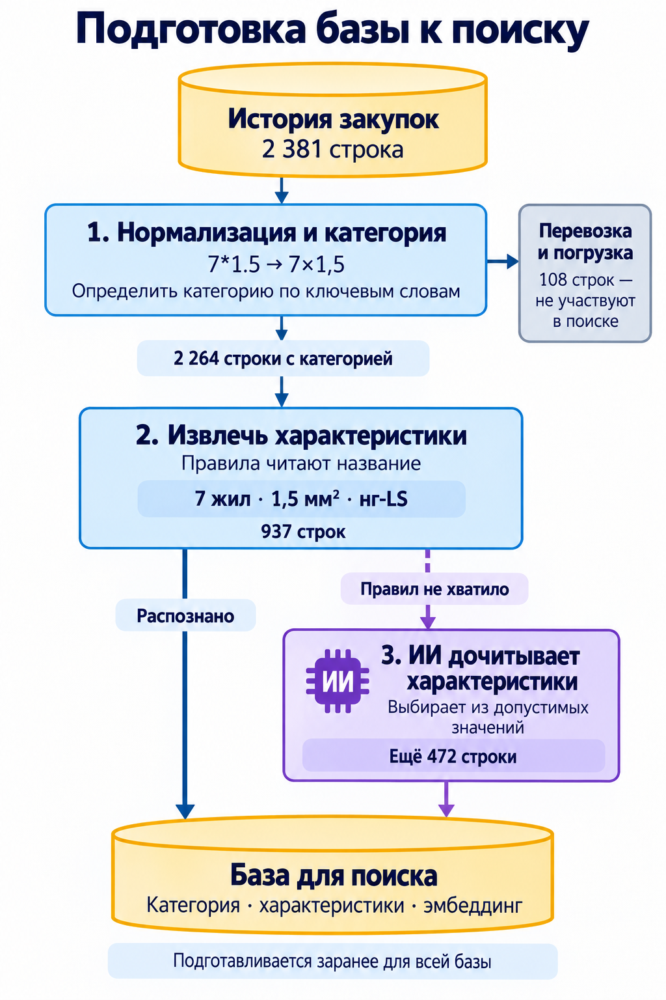
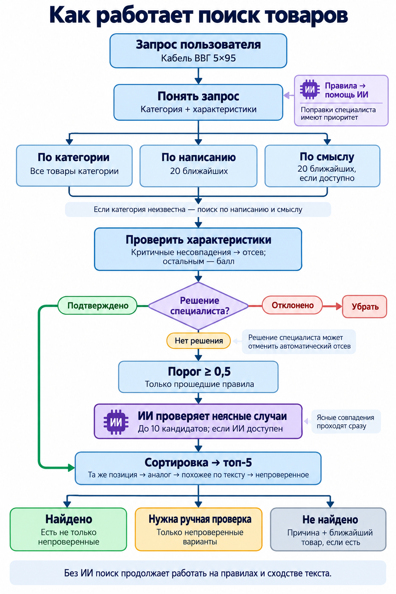
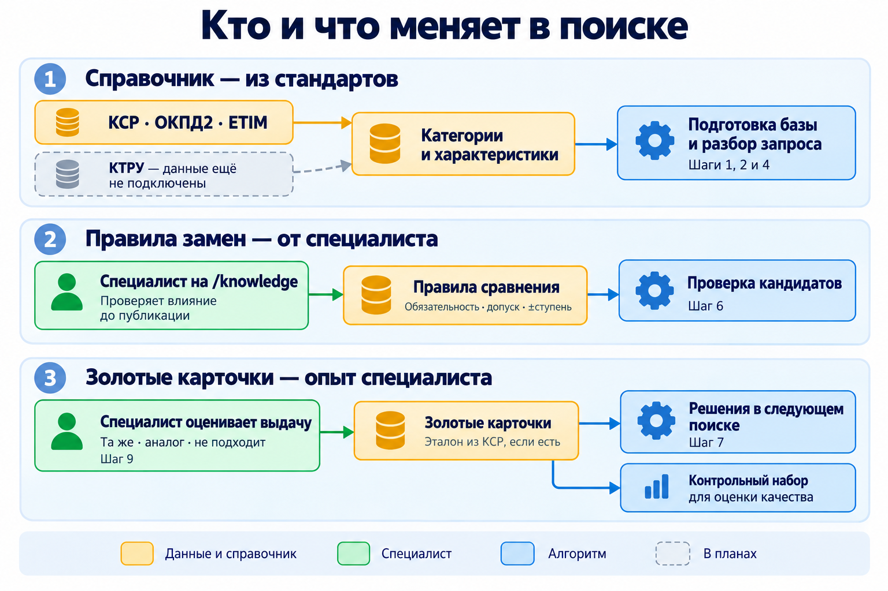
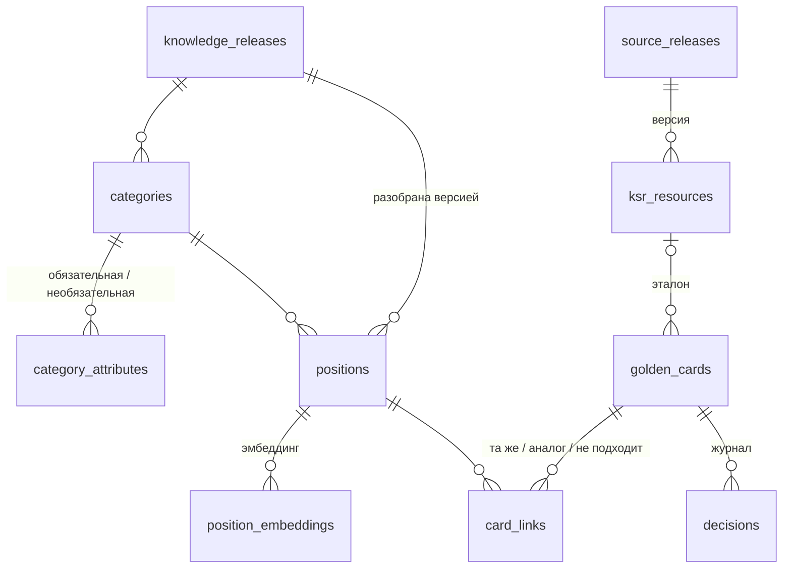

# Поиск аналогов позиций: как устроен

## Идея простыми словами

Поиск состоит из трёх частей, каждая — примерно треть результата поиска.

1. **Справочник.** Собираем большую базу: какие бывают категории товаров, какие у них характеристики, какие
  термины и сокращения встречаются. Берём её из готовых стандартов (КСР, ОКПД2, ETIM, позже КТРУ). Потом и
   запрос, и каждую строку истории переводим на язык этого справочника. Например, «кабель КВВГнг-LS 7*1.5»
   становится «кабель контрольный, 7 жил, 1,5 мм², нг-LS». Здесь нет ИИ, только правила, поэтому результат
   всегда одинаковый. Чем лучше справочник, тем лучше поиск.
2. **Правила специалиста.** Специалист для каждой категории говорит, что важно. Например: у кабеля сечение
  должно совпадать точно, а камеру можно взять на одну ступень лучше по разрешению. По этим правилам система
   решает: это та же позиция, аналог или не подходит. Название при этом не важно — важны характеристики.
3. **ИИ.** Он нужен в двух случаях. Первый — ранжировать то, что уже прошло первые два шага.
  Второй — когда запрос написан с ошибками или своими словами («бесперебойник», «семь жил») и первые два
   шага его не поняли. Тогда запрос идёт через ИИ-флоу: ИИ пытается распознать текст, а дальше запрос идёт
   по обычным правилам (шаги 1 и 2). Отменить правило ИИ не может.
4. Отдельна часть c золотыми карточками - по мере накпопления данных выборов по конкретным позициям специалистами мы можем показывать данные по опыу выбора.

Дальше — как это устроено.

---

## 1. Схема поиска

Три схемы: что готовится заранее, что происходит на каждый запрос, кто и что правит. Номер в блоке — номер
шага в §2. Числа — реальный запрос `кабель КВВГнг-LS 7*1.5` по базе из задания.

Легенда: 🟦 код · 🟪 ИИ (только выбирает из готового списка) · 🟨 данные и справочник · 🟩 человек ·
⬜ пунктир — не сделано в прототипе. Пунктирная стрелка — запасной путь, когда правила не справились.

### 1.1. Заранее — один раз для всей базы

[Исходник схемы](docs/diagrams/01-data-preparation.mmd)

### 1.2. На каждый запрос

[Исходник схемы](docs/diagrams/02-search-flow.mmd)

ИИ или эмбеддинги недоступны — поиск не падает: идёт по тому, что прочли правила и нашли триграммы.
Ответ ИИ с уверенностью ниже 0,9 не используется. Отсеянные строки в выдачу не идут и ИИ их не видит —
они нужны только чтобы объяснить «не найдено».

### 1.3. Кто и что правит

[Исходник схемы](docs/diagrams/03-knowledge-and-feedback.mmd)

**Та же позиция или аналог.** И запрос, и строки базы сводятся к одному виду: категория + характеристики.
Дальше всё решают характеристики, а не текст:

- все обязательные совпали — **та же позиция**, даже если написано по-разному (`6000х2250` и `2250х6000 мм`);
- обязательные совпали, остальное отличается или лучше — **аналог**, и система пишет, чем он отличается;
- обязательная не совпала — кандидат отсеивается; если отсеялись все, показываем «не найдено» и ближайшую
строку с причиной;
- обязательные проверить не удалось — показываем с пометкой **«не проверено»**, но найденным не считаем.

---

## 2. Шаги

Всё, что «настраивается», меняется без программиста: специалист правит правила на странице `/knowledge`,
все правила поиска — веса, порог, top-K, уверенность модели, лимиты запроса — заданы в одном месте, `src/app/search_config.py`. Слабые места шагов и что с ними делать — в §6.

**Заранее, для всей базы**

1. **Нормализация и категория.** Приводим запись к одному виду: `7*1.5`, `7 на 1,5`, «семь на полтора» —
  всё становится `7x1.5`. Категорию определяем по ключевым словам: «кабель», «лоток», «камера». Есть и
   слова-исключения: «кабель-канал» — это не кабель. Перевозку и погрузку помечаем и в выдачу не берём.
   *Настраивается:* ключевые слова и исключения.
2. **Характеристики.** Вытаскиваем из названия то, что важно для категории: жилы и сечение, мощность, IP,
  размеры. Правило простое: не уверены — не берём. *Настраивается:* какие характеристики есть у категории
   и какие из них обязательные.
3. **ИИ дочитывает.** Если правила характеристику не распознали, ИИ выбирает значение из списка допустимых.
  Число должно реально быть в строке, неуверенный ответ выкидываем. *Настраивается:* список значений и
   порог уверенности.

**На каждый запрос**

1. **Разбор запроса.** Те же нормализация, категория и характеристики, что и для базы. Если категорию не
  распознали («бесперебойник»), ИИ выбирает её из 8 ближайших или честно говорит «ни одна». Числа словами
   («семь жил») тоже разбирает ИИ. Пока человек печатает — подсказки и исправление опечаток. Над выдачей
   видно, что поняла система, и это можно поправить руками.
2. **Отбор кандидатов.** Берём три группы: все строки той же категории, 20 самых похожих по написанию (ловит
  марки и опечатки) и 20 самых похожих по смыслу (ловит синонимы). Похожие из других категорий — страховка,
   если категория определилась неверно. *Настраивается:* сколько похожих брать.
3. **Сравнение по правилам.** Каждая характеристика сравнивается по своему правилу: «точно равно», «не хуже»
  (IP65 вместо IP54 — можно), «±1 ступень» (камера 4 Мп вместо 2 Мп). Не совпала обязательная — кандидат
   отсеивается, необязательная — штраф. *Настраивается:* обязательная или нет, правило, допуск.
4. **Золотая карточка.** Карточка — типовая позиция, которую уже разбирал специалист. Её ключ — категория и
  характеристики запроса, а не текст: «ИБП 12В для улицы» и «бесперебойник 12 вольт уличный» попадают в одну
   карточку. Если у запроса есть карточка: строки с отметкой «та же» и «аналог» идут наверх, даже если
   правило против (это повод пересмотреть правило), строки с «не подходит» убираются. Строки без отметки
   идут дальше обычным путём. *Настраивается:* отметками специалиста на шаге 9.
5. **Скоринг и порог.** Текст, характеристики и категория дают итоговый балл; ниже порога не показываем.
  Строки, где правила проверили все обязательные характеристики, идут в выдачу без ИИ. ИИ смотрит только
   остальные: где характеристику проверить не удалось или совпал лишь текст — и отвечает «та же», «аналог» или
   «другое». *Настраивается:* веса и порог.
6. **Специалист.** Отмечает результаты: «та же», «аналог», «не подходит». Отметка пишется в золотую карточку
  запроса (нет карточки — создаётся), и тот же запрос другими словами получит её сразу (шаг 7). Карточка
   привязывается к эталону из КСР, если он там есть; все карточки вместе — готовый контрольный набор для
   оценки качества. Правила специалист меняет на `/knowledge`: перед публикацией видно, как изменится выдача
   на контрольных запросах, после — вся база пересчитывается.

---

## 3. Где ИИ, где код, где человек

| Кто                     | Что делает                                                                                                     | Почему так                                                      |
| ----------------------- | -------------------------------------------------------------------------------------------------------------- | --------------------------------------------------------------- |
| **Код**                 | нормализация, категория, характеристики, сравнение, правила, скоринг                                           | точно, одинаково каждый раз, можно объяснить                    |
| **ИИ** (Jev Choice)     | дочитывает характеристики (3, 4), проверяет то, что правила не решили (8) — всегда выбирает из готового списка | понимает опечатки и числа словами; неуверенный ответ выкидываем |
| **Эмбеддинги** (bge-m3) | ближайшие категории (4), похожие по смыслу (5)                                                                 | находят синонимы без общих букв; только отбирают, не решают     |
| **Специалист**          | правила: что обязательно, какие замены можно; решения по выдаче (9)                                            | методика замен — это его знание; правит без программиста        |
| **Пользователь**        | поправляет, как система поняла запрос (4)                                                                      | самый быстрый способ обойти ошибку разбора                      |

**Почему не отдать всю базу в LLM:** не влезает и дорого (§4), не умеет честно сказать «не найдено», не
объясняет выбор, путает `7×1,5` и `7×2,5`, на один и тот же запрос отвечает по-разному.

---

## 4. Хранилище и модели: что выбрано и почему

| Решение                                                   | Почему                                                                                    | Почему не другое                                                                 |
| --------------------------------------------------------- | ----------------------------------------------------------------------------------------- | -------------------------------------------------------------------------------- |
| **PostgreSQL 17 + `pg_trgm` + `pgvector`**                | строки, разметка, эмбеддинги, правила, справочники — всё в одной базе, с версиями         | в памяти — нет версий и долгий старт; отдельная векторная БД пока лишняя         |
| **Триграммы + эмбеддинги**                                | триграммы ловят опечатки и марки (`КВВГнг` ↔ `КВВГЭнг`), эмбеддинги — синонимы            | только эмбеддинги путают марки; только триграммы не свяжут «бесперебойник» и ИБП |
| **Jev Choice — выбор, а не генерация**                    | модель выбирает из списка и даёт уверенность: значение не выдумает, можно поставить порог | обычная LLM пишет текст — его надо парсить и проверять; дообучать пока не на чем |
| **Правила — версии в базе** (YAML — стартовое наполнение) | специалист правит без программиста; у каждой правки есть автор, причина и версия          | правила в коде или промпте специалист не поправит и не проверит                  |
| **Решения специалиста — две таблицы**                     | ключ — категория + характеристики запроса; простой JOIN                                   | графовая БД не нужна: «аналог» не цепочка, обходить нечего                       |
| **Без Elasticsearch**                                     | опечатки, подсказки, триграммы и эмбеддинги PostgreSQL отдаёт за 10–40 мс                 | нужен на миллионах строк с фильтрами и морфологией                               |

**Справочники** грузятся версиями: КСР (83 523 позиции — эталон для решений специалиста), ОКПД2, ETIM 10.
КТРУ — загрузчик готов, сами данные — следующий шаг.

### Сколько стоит

Модель и эмбеддинги — через OpenRouter, цены на 17.10.2026, расход замерен по счётчику ключа.

- **Запросы:** 1 000 в день — **≈ $1,5 в месяц**; 10 000 в день — ≈ $15; 100 000 в день — ≈ $150.
- **Разбор базы, один раз:** 2 381 строка — $0,04 (замер); 100 000 строк — **≈ $1,6**; 500 000 — ≈ $8.
- Для сравнения — отдать всю базу в LLM: на 500 000 строк ≈ $0,6 за **один** запрос, и она всё равно не влезет.

### Локальная замена Jev: Laya, дообученная на истории

Сейчас Jev — закрытая модель через интернет. Мы даём ей текст и вопрос с вариантами («сколько жил: 3, 5, 7,
не указано?»), она выбирает вариант и говорит, насколько уверена. На один запрос её вызывают до трёх раз:
категория, характеристики, проверка.

Когда база вырастет, её заменит **Laya** (Convai Innovations, Apache 2.0) — открытая модель того же типа:
не пишет текст, а выбирает ответ из вариантов. Работает на нашем сервере:

- **тот же контракт** — «текст + вопрос с вариантами → вариант + уверенность»; в поиске меняется только
модуль подключения модели;
- **быстро и дёшево** — маленькая модель (≈ 0,4 млрд параметров), десятки миллисекунд на ответ на одной
видеокарте; все вопросы по запросу — за один проход вместо трёх вызовов;
- **учится на нашей истории** — без дообучения такие модели угадывают слабо, поэтому дообучаем её на
разобранной базе и решениях специалиста; чем больше решений, тем лучше она знает наши марки и сокращения;
- **платим за сервер, а не за запросы**; данные заказчика никуда не уходят; нет зависимости от чужого API.

Что проверить до перехода: основная версия Laya английская — нужно проверить её на русских названиях или
дообучить на них; сравнить с Jev на контрольных запросах и заново подобрать пороги уверенности.

---

## 5. Качество: как измерено

Скрипт `evaluation/evaluate.py` гоняет ту же логику без базы. Для сравнения есть baseline — обычный поиск по
словам, без категорий и правил. Всего 52 контрольных запроса в 8 группах, в 13 из них правильный ответ —
«не найдено».

| Группа     | Запросов | Что проверяет                                        | Правила + ИИ | Только правила | Baseline |
| ---------- | -------- | ---------------------------------------------------- | ------------ | -------------- | -------- |
| task       | 7        | запросы из задания                                   | 7            | 7              | 4        |
| paraphrase | 8        | реальные строки, переписанные другими словами        | 8            | 8              | 4        |
| near_text  | 6        | похоже по тексту, но другое по сути                  | 6            | 6              | 6        |
| no_match   | 2        | такого в базе точно нет                              | 2            | 2              | 0        |
| section    | 6        | сечения (АС 240/39, ТМЛ 50, 3×2,5+1×1,5)             | 6            | 6              | 0        |
| llm        | 3        | характеристику понимает только ИИ                    | 3            | 2              | 2        |
| words      | 12       | своими словами: опечатки, числа словами              | 12           | 7              | 3        |
| held_out   | 8        | своими словами, написаны после настройки, до прогона | 7            | 4              | 5        |

| Метрика                                                             | Правила + ИИ | Только правила | Baseline |
| ------------------------------------------------------------------- | ------------ | -------------- | -------- |
| hit@1 — правильная строка на первом месте                           | 0,97         | 0,77           | 0,62     |
| misplace@1 — на первом месте строка с другой важной характеристикой | 0,00         | 0,07           | 0,33     |
| no_match_ok — честно сказал «не найдено»                            | 1,00         | 0,92           | 0,00     |
| false_found — что-то показал там, где ответа нет                    | 0,00         | 0,08           | 1,00     |

Запрос занимает 0,7–2,2 с с ИИ и 14 мс на одних правилах. **Честно:** контрольные запросы писал тот же
человек, что настраивал поиск. Группу words улучшали по её же ошибкам (было 4 из 12, стало 12), поэтому после
настройки отдельно записали held_out — до прогона: сначала 3 из 8, после правок 7 из 8. Нужен независимый
набор от специалиста (§6).

**Разбор ошибок:**

| Ошибка                                           | Почему                                                                            | Что исправило / исправит                                 |
| ------------------------------------------------ | --------------------------------------------------------------------------------- | -------------------------------------------------------- |
| «ТМЛ 50» показывал ТМЛ 35 и 120 как аналоги      | размер в марке не распознавался, а нераспознанная обязательная молча пропускалась | пометка «не проверено»; марку теперь читает правило      |
| «воздуховод d=200» находил 500                   | число бралось не из того места строки                                             | отдельное правило для диаметра воздуховода               |
| «семь жил по четыре квадрата» — правила не нашли | правила не понимают числа словами                                                 | ИИ выбирает из списка — нашлось                          |
| «витая пара пятая категория» — «не проверено»    | порядковое число словом, ИИ не уверен                                             | синонимы в списке значений («пятая» = 5e) от специалиста |

**Семь запросов из задания:**

| Запрос                                  | Результат                                                                                                                                                                                                                 |
| --------------------------------------- | ------------------------------------------------------------------------------------------------------------------------------------------------------------------------------------------------------------------------- |
| `кабель КВВГнг-LS 7*1.5`                | 2 **аналога** 7×1,5: с экраном, FRLS вместо LS; 7×2,5, 5×1,5, 14×1,5 отсеяны                                                                                                                                              |
| `камера IP уличная 2 Мп вариофокальная` | 3 **аналога** 2 Мп: моторизованный объектив вместо вариофокального                                                                                                                                                        |
| `ворота откатные 6000х2250`             | **та же**: «Ворота откатные 2250х6000 мм»                                                                                                                                                                                 |
| `труба гофра ПВХ 25 мм`                 | 2 **те же**: d=25, ПВХ                                                                                                                                                                                                    |
| `ИБП 12В для улицы`                     | **та же**: уличный ИБП 12 В (строка 1541). Задание ждало «не найдено», но такая строка в базе есть                                                                                                                        |
| `трансформатор силовой сухой 1000 кВА`  | **не найдено**: ближайший — 1250 кВА. Если разрешить +1 ступень, станет аналогом — решает специалист. В демо специалист уже решил (`demo/decisions.json`): в интерфейсе 1250 кВА показан **аналогом** по золотой карточке |
| `огнетушитель порошковый ОП-5`          | **не найдено**: огнетушителей в истории нет                                                                                                                                                                               |

---

## 6. Ограничения и план

**Если база вырастет до 500 тыс. строк.** Сломается отбор «все строки категории» (у кабеля их будут тысячи)
и перебор всех эмбеддингов. Нужно: ограничить число кандидатов, проверять обязательные правила прямо в
запросе к базе, добавить индекс для эмбеддингов (HNSW), при большом потоке — отдельное векторное хранилище и
кэш частых запросов, новые строки разбирать в фоне. Деньги здесь не проблема (§4).

**Как специалисту добавить правило без кода.** На странице `/knowledge`: меняет правило (обязательная или
нет, как сравнивать, допуск, ключевые слова) → «Проверить влияние» на контрольных запросах →
«Опубликовать», и вся база пересчитывается. Новую характеристику пока добавляет программист — её нужно
научить распознавать.

**Как решения специалиста улучшают выдачу.** Сразу: тот же запрос любыми словами получает подтверждённое
наверху и не получает отклонённое. Дальше эти решения — источник знаний, которых у системы нет (см. таблицу).

**Слабые места и следующие шаги:**

| Сейчас                                                                     | Что делаем                                                                                                | Приоритет | Дни |
| -------------------------------------------------------------------------- | --------------------------------------------------------------------------------------------------------- | --------- | --- |
| Контрольные запросы писал тот же человек, что настраивал                   | независимый набор от специалиста (100 запросов), замер на реальном потоке                                 | P0        | 3   |
| Правила замен — наше допущение                                             | утвердить правила для 30 главных категорий со специалистом                                                | P0        | 3   |
| 117 строк без категории, у 60 % товаров не распознаны характеристики       | догрузить КТРУ, ОКПД2, ETIM; списки значений, чтобы их дочитывал ИИ                                       | P0        | 4   |
| Решения специалиста работают только для запроса с теми же характеристиками | брать «та же» и «аналог» из решений по похожим запросам; частые правки пользователей → предложения правил | P1        | 3   |
| Отбор «вся категория» и перебор эмбеддингов не выдержат 500 тыс.           | лимит кандидатов, правила в запросе к базе, HNSW                                                          | P1        | 3   |

Дальше: локальная модель вместо внешнего API (§4), разбор составных позиций «… в составе:».

---

## 7. Вопросы защиты

1. **Почему не обычный поиск по словам или просто LLM?** Поиск по словам не отличает 7×1,5 от 7×2,5 и никогда
  не говорит «не найдено» (false_found 1,00). LLM тоже не умеет честно отказать и не объясняет выбор (§3).
2. **«Сечение кабеля — строго»: где это и кто меняет?** В правилах: `сечение_жилы` — обязательная, «точно
  равно». Специалист на `/knowledge` может поставить «±1 ступень» — и 7×2,5 станет аналогом без кода.
3. **Как поиск становится лучше со временем?** Решения специалиста работают сразу, потом идут в контрольный
  набор, правила и дообучение модели (§6).
4. **Выдача неверная — как найти ошибку?** Смотрим «Что поняла система»: не та категория — шаг 1 или 4, не та
  характеристика — шаг 2. У кандидата видно, каким правилом он отсеян (шаг 6). Запрос добавляем в
   контрольный набор, чиним, прогоняем тесты и оценку.
5. **Другой справочник или другой заказчик?** Код не меняется — меняются правила и веса.
6. **Зачем эмбеддинги, если решают характеристики?** Чтобы найти, что сравнивать: у «бесперебойника» и «ИБП»
  нет общих букв. Решают всё равно правила.
7. **Может ли ИИ переспорить правило?** Нет: отсеянное правилом он не видит, а строку чужой категории выше
  аналога не поднимет.
8. **Специалист ошибся с «та же»?** Пострадает одна связь; следующее решение её заменит, в журнале останутся оба.
