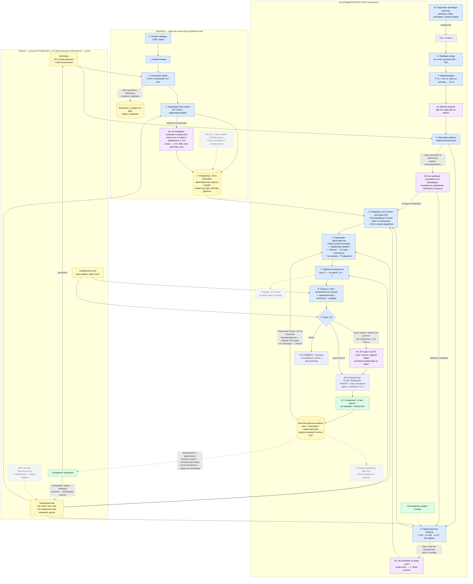
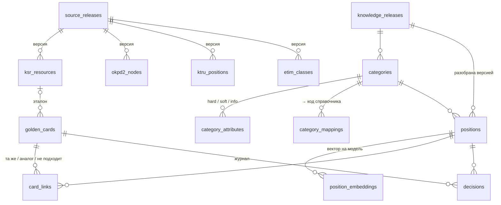

# Поиск аналогов позиций: как устроен

Пользователь вводит наименование материала или оборудования своими словами. Система возвращает до 5 позиций
из истории закупок и про каждую говорит: это **та же позиция**, **допустимый аналог** (и чем отличается) — или
честно отвечает **«не найдено»** и объясняет почему.

Главная идея: искать не похожий *текст*, а похожую *вещь*. Система сначала понимает, что это за вещь
(категория) и какие у неё параметры (характеристики), и только потом сравнивает — по правилам, которые задаёт
специалист, а не программист.

---

## 1. Схема

Легенда: 🟦 код (детерминированно) · 🟪 ИИ (выбор из ряда, проверяется кодом) · 🟨 данные и знания · 🟩 человек ·
⬜ серый пунктир — не реализовано в прототипе (план — §6, `docs/limits.md`).
Числа на стрелках — реальный прогон запроса `кабель КВВГнг-LS 7*1.5` по базе из задания.

Как схема отличает **ту же позицию под другим названием** от **допустимой замены**: оба названия приводятся к
одной структуре `{категория, характеристики}`. Совпали все характеристики запроса — это та же позиция, даже если
текст разный (`6000х2250` и `2250х6000 мм`). Обязательные (hard) выполнены, но что-то отличается, лучше
требуемого или не указано — это аналог, и система пишет, что именно. Нарушена обязательная — кандидат в выдачу
не попадает вообще; если так отсеяны все, ближайший показывается в блоке «не найдено» с причиной.

---
## 2. Шаги по порядку

Подробно, с тем, что каждый шаг ловит и где ошибается, — [docs/steps.md](docs/steps.md).

**Заранее, со всей базой** (`positions load`):

| Шаг | Что делает | Пример / граница |
|---|---|---|
| 0. Чтение | строка, наименование, цена; номер строки — постоянный ключ | перезагрузка не ломает решения специалиста |
| 1. Нормализация | регистр, `ё`, номер пункта, размеры к одному виду | `7*1.5`, `7 на 1,5`, «семь на полтора» → `7x1.5` |
| 2. Категория | слова-признаки с начала слова, слова-исключения, «(прочее)» уступает точной | «кабель-канал» — не кабель; 117 строк (4,9 %) без категории |
| 3. Характеристики | экстракторы по схеме категории, единицы к одной | `нг(А)-FRLS`, «Э» в марке — экран; «3х2,5+1х1,5» отклоняется: **не уверен — не извлекай** |
| 3а. Модель дочитывает | hard с рядом значений, которые не прочитали правила: Jev **выбирает** вариант ряда, «не из списка» или «не указано» | число должно быть в строке и уверенность ≥ 0,8, слово — ≥ 0,9; неуверенный ответ = нет ответа |
| 4. Хранение | PostgreSQL: категория, характеристики (JSON), текст с индексом `pg_trgm`, вектор bge-m3, версия знаний | `/api/stats` предупреждает, если база разобрана старым релизом |

**На каждый запрос** (`POST /api/search`):

| Шаг | Что делает | Пример / граница |
|---|---|---|
| 1б. Подсказки при вводе | опечатка, дописать слово, категория, строки истории (`GET /api/suggest`); само не применяется | «кабль конт» → «кабель контрольный»; «rf,tkm» → «кабель» |
| 1. Проверка входа | пусто, одни знаки, > 500 символов → 400; сбой → 500 с `trace_id` | — |
| 2–4. Разбор | те же функции, что для базы: сравниваются структуры, а не строки | «кабель контрольный · 7 жил · 1,5 мм² · нг-LS» |
| 2а. Вектор запроса | bge-m3, один раз: для категории и кандидатов по смыслу | — |
| 3б. Категория моделью | слова-признаки не сработали → Jev выбирает из 8 ближайших (по написанию и смыслу) или «ни одна» | «бесперебойник» → ИБП; «насос» → ни одна |
| 4а. Характеристики моделью | hard и soft, числа словами; проверка как в 3а | «семь жил», «тридцать ватт» |
| 4б. Правка разбора | разбор показан как фильтры магазина; пользователь меняет категорию, значение из ряда, «не указано» | ошибка разбора обходится сразу, без правки правил |
| 5. Кандидаты | все строки категории + 20 ближайших по всей базе по написанию + 20 по смыслу | чужие строки — на случай ошибки категории |
| 6. Сравнение | по типу из знаний: равно, не хуже, не больше, ступень ± N, включает, без порядка | IP65 вместо IP54 — можно; FRLS заменяет LS, не наоборот; строка чужой категории — правилами запроса |
| 7. Правила специалиста | hard ✗ → исключён; soft отличается → штраф; info — показ | 26 → 2 для `7*1.5` |
| 8. Оценка и метка | `0,35·текст + 0,45·характеристики + 0,20·категория − штрафы`; метка — см. ниже | веса — `config/search.yaml` |
| 9. Порог 0,5 | до 5 результатов или «не найдено» с причиной и ближайшей строкой | пять случайных строк — никогда |
| 9а. Судья | Jev по 10 лучшим нерешённым: та же / аналог / другой товар; отсеянное hard не видит | «другой товар» убирает строку; чужая категория — не выше аналога |
| 10. Специалист | «та же / аналог / не подходит / пропустить» → золотая карточка по **структуре** запроса | подтверждённое — первым, отклонённое — убрано, сильнее правила |
| 11. Правка знаний | `/knowledge`: черновик → проверка влияния → публикация релиза → переразбор базы | подсказки из расхождений карточек с правилами сами не применяются |

**Метки.** **Та же** — каждая hard прочитана у обоих и совпала. **Аналог** — hard не нарушены, хотя бы одна
подтверждена, остальное отличается или лучше. **Не проверено** — hard не нарушены, но ни одна не подтверждена
(в ответе — что проверить руками). **По тексту** — категория запроса не распознана.

**Причины «не найдено»:** `category_absent` (огнетушителей в истории нет), `hard_mismatch` (ТСЗ-1250 вместо
1000 кВА), `low_score`, `unverified`, `dismissed` (судья или специалист отверг все), `unknown_category`.

**Почему не графовая БД для карточек.** «Аналог» не транзитивен и направлен, обходить дальше шага нечего —
хватает двух таблиц PG и JOIN. Карточки сами не сливаются: ошибочное «та же» не склеит кластеры.

### Семь запросов из задания

| Запрос                                  | Что происходит                                                                            | Итог                                                                                                      |
| --------------------------------------- | ----------------------------------------------------------------------------------------- | --------------------------------------------------------------------------------------------------------- |
| `кабель КВВГнг-LS 7*1.5`                | кабель контрольный, 26 строк; 7×2,5, 5×1,5, 14×1,5 и т. п. отсеяны (hard)                 | 2 **аналога**: КВВГЭнг(A)-LS 7×1,5 и КВВГЭнг(A)-FRLS 7×1,5 — у них экран, FRLS покрывает LS               |
| `камера IP уличная 2 Мп вариофокальная` | разрешение ±1 ступень; объектив по ряду «фиксированный → вариофокальный → моторизованный» | 3 **аналога** (строки 428, 887, 480): 2 Мп, объектив моторизованный — покрывает вариофокальный            |
| `ворота откатные 6000х2250`             | габарит без порядка сторон                                                                | **та же**: «Ворота откатные 2250х6000 мм»                                                                 |
| `труба гофра ПВХ 25 мм`                 | «гофра» → труба гофрированная, диаметр 25                                                 | 2 **те же** d=25 ПВХ; ПНД d25 (строка 1270) — на пороге, ниже                                             |
| `ИБП 12В для улицы`                     | 12 В DC, уличное исполнение                                                               | **та же**: уличный ИБП SKAT-V.12DC-18 (строка 1541)                                                       |
| `трансформатор силовой сухой 1000 кВА`  | 2 строки: ТСЗ-1250 — сухой, но мощность hard с допуском 0; ТДТН-25000 — масляный          | **не найдено**, ближайший ТСЗ-1250 с причиной. Допуск +1 ступень сделает его аналогом — решает специалист |
| `огнетушитель порошковый ОП-5`          | категория известна, в базе 0 строк                                                        | **не найдено**: огнетушителей в истории нет                                                               |

**Расхождение с ожиданием задания:** для «ИБП 12В для улицы» ожидалось «не найдено», но в базе есть строка 1541 —
уличный источник бесперебойного питания 12 В DC. Мы считаем её верным ответом и так записали в контрольный набор.

---

## 3. Где ИИ, где код, где человек

| Кто | Что делает | Почему так |
|---|---|---|
| **Код** | нормализация, категория, характеристики, сравнение, правила, оценка, решение | числа и правила сравниваются точно, повторяемо, объяснимо |
| **ИИ** (Jev Choice) | дочитывает, что не прочитали правила (3а, 3б, 4а), судит нерешённых кандидатов (9а) — всегда **выбором** из справочника | понимает опечатки и числа словами; число сверяется со строкой, неуверенный ответ отбрасывается, решает код |
| **Эмбеддинги** (bge-m3) | ближайшие категории (3б), кандидаты по смыслу (5) | ловят синонимы без общих букв; только отбирают, не решают |
| **Специалист** | hard / soft / допуски и слова-признаки на `/knowledge`; вердикты по кандидатам (10) | методика замен — его знание; правит без программиста, влияние видно до публикации |
| **Пользователь** | правит разбор своего запроса (4б) | самый дешёвый обход ошибки разбора |

Модель и векторы идут через OpenRouter, ключ `OPENROUTER_API_KEY` обязателен и читается только из окружения.

**Почему не отдать всю базу LLM:** не влезает в окно и дорого (§4), нет честного «не найдено», выбор не
объясним и не чинится правилом, числа `7×1,5` и `7×2,5` путает, ответ невоспроизводим.

---

## 4. Хранилище и модели: что выбрано и почему

| Решение | Почему | Почему не альтернатива |
|---|---|---|
| **PostgreSQL 17 + `pg_trgm` + `pgvector`** | строки, разметка, векторы, знания, справочники — одна база с версиями | в памяти — нет версий и долгий старт; отдельная векторная БД — лишняя инфраструктура |
| **Триграммы + эмбеддинги** | триграммы — опечатки и марки (`КВВГнг` ↔ `КВВГЭнг`), векторы — синонимы | только векторы хуже на марках; только триграммы — «бесперебойник» не находит ИБП |
| **Jev Choice — выбор, а не генерация** | вариант из ряда с вероятностью: значение не выдумать, есть порог | LLM с JSON — парсить и сверять с рядом; дообучение — нет разметки |
| **Знания — релизы в PG** (YAML — начальное наполнение) | специалист правит без git и деплоя; автор, причина, релиз у каждой правки | правила в коде или промпте — не правит специалист, не проверяемы |
| **Карточки — две таблицы PG** + журнал `decisions` | ключ — структура запроса; один JOIN | графовая БД — обходить нечего (§2) |
| **Без Elasticsearch** | опечатки, подсказки, триграммы, векторы закрыты PG за 10–40 мс | нужен на миллионах строк с фасетами и морфологией |
| **Слои**: `domain` → `repositories` → `services` → `app` | правила без БД: та же логика на `MemoryStore` в тестах и оценке | — |

**Справочники** грузятся релизами (`источник + версия + sha256`), две версии лежат рядом: КСР (83 523 ресурса —
эталон карточки), ОКПД2 (21 102 кода), ETIM 10 (5 640 классов); КТРУ — загрузчик готов, данные — следующий шаг.
В рантайме поиска участвует только КСР (эталон), остальные — источник правил в yaml.

### Прод на 500 тыс. строк: что берём и сколько стоит

Цены OpenRouter на 17.10.2026: Jev 1.13 — $0,042 за 1 млн входных токенов, ответ бесплатно; bge-m3 — $0,01 за
1 млн. Расход **замерен** по счётчику ключа.

| Что | Сейчас: 2 381 строка (замер) | 500 тыс. строк |
|---|---|---|
| Разбор базы моделью, один раз | $0,038 и 170 с (1 110 вопросов + 2 273 вектора) | ≈ $8; ≈ 10 ч в 8 потоков, 1–2 ч в 64 |
| Векторы названий | < $0,001 | ≈ $0,15 через API; в проде — локальная bge-m3 |
| Запрос своими словами | $0,00005, 0,7–2,2 с | столько же: от базы не зависит |
| 10 тыс. запросов в день | — | ≈ $15 в месяц |
| «Отдать всю базу LLM» | — | ≈ 15 млн токенов на **один** запрос (окно Jev — 262 тыс.), ≈ $0,6 и минуты |

**Хранилище — тот же PostgreSQL:** кандидаты по `pg_trgm` с лимитом вместо «вся категория», hard-правила в SQL
по JSONB-индексу, HNSW вместо перебора векторов, разбор новых строк — фоновой очередью.

**Jev в проде — да, с тремя условиями:** деньги не ограничение, а задержка и лимиты — разбор базы фоном, ответы в
кэше; закрытый контур — локальная модель с выбором из списка (Qwen + vLLM), меняется один адаптер
`infrastructure/llm`; API в статусе alpha — при недоступности поиск идёт по правилам, для прода нужен SLA или
локальная замена.

---

## 5. Качество: как измерено

`evaluation/evaluate.py` — без БД, та же логика на хранилище в памяти (сходство — как `pg_trgm`, проверено
тестом). Baseline — поиск по словам без категорий и правил. 52 запроса в 8 группах, из них 13 ждут «не найдено»:

| Группа | Запросов | Что проверяет | Правила + ИИ | Только правила | Baseline |
|---|---|---|---|---|---|
| task | 7 | запросы из задания | 7 | 7 | 4 |
| paraphrase | 8 | перефразировки реальных строк | 8 | 8 | 4 |
| near_text | 6 | похожие по тексту, другие по сути | 6 | 6 | 6 |
| no_match | 2 | заведомо отсутствующие | 2 | 2 | 0 |
| section | 6 | сечения (АС 240/39, ТМЛ 50, 3×2,5+1×1,5) | 6 | 6 | 0 |
| llm | 3 | характеристику читает только модель | 3 | 2 | 2 |
| words | 12 | своими словами: опечатки, числа словами | 12 | 7 | 3 |
| held_out | 8 | своими словами, записаны после настройки, до прогона | 7 | 4 | 5 |

| Метрика | Правила + ИИ | Только правила | Baseline |
|---|---|---|---|
| hit@1 — верная строка первой | 0,97 | 0,77 | 0,62 |
| misplace@1 — первой строка с другим ключевым параметром | 0,00 | 0,07 | 0,33 |
| no_match_ok — честное «не найдено» | 1,00 | 0,92 | 0,00 |
| false_found — выдал что-то, где ответа нет | 0,00 | 0,08 | 1,00 |

Запрос — ~210 мс с моделью из кэша, 14 мс по правилам; live — плюс 0,3–0,6 с на каждый вопрос модели.
**Честно:** набор и настройка — от одного автора; words улучшена по её же ошибкам, поэтому held_out записана до
прогона (3 → 7 из 8). Подробно — [docs/quality.md](docs/quality.md).

---

## 6. Ограничения и план

**500 тыс. строк.** Не выдержит отбор «все строки категории» (в кабеле — тысячи) и полный перебор векторов.
Нужны лимит по `pg_trgm` (GIN-индекс уже есть), hard-правила в SQL по JSONB-индексу, HNSW-индекс pgvector,
векторы — локальной bge-m3, разбор новых строк — фоном. Модель по деньгам выдерживает: Jev ≈ $8 на всю базу
один раз, ≈ $0,00005 на запрос. Узкие места — лимиты API и вывод данных наружу (§4, «Прод на 500 тыс. строк»).

**Правило специалиста без кода.** Страница `/knowledge`: правка (уровень, сравнение, допуск, слова-признаки) →
«Проверить влияние» на контрольном наборе → «Опубликовать». Вся база переразбирается новым релизом. Новая
характеристика пока требует разработчика: ей нужен экстрактор или ряд для модели.

**Подтверждения специалиста.** Сразу — золотая карточка: тот же запрос любыми словами получает подтверждённое
первым и не получает отклонённое. Затем подтверждения становятся контрольными примерами, исправленные категории —
кандидатами в слова-признаки. В правила это попадает только после просмотра специалистом.

**Главные слабые места.** Правила замен — наше допущение. У 60 % строк характеристики не извлечены. 66
hard-правил некому проверить. Набор из 52 запросов составил тот же автор, что настраивал поиск. Полный список — [docs/limits.md](docs/limits.md).

| Приоритет | Шаг                                                                              | Дни |
| --------- | -------------------------------------------------------------------------------- | --- |
| P0        | Независимый контрольный набор от специалиста, 100 запросов                       | 2   |
| P0        | Утвердить hard/soft для топ-30 категорий со специалистом                         | 3   |
| P0        | Ряды значений для 66 непроверяемых hard — их начнёт дочитывать модель            | 2   |
| P1        | Экстракторы для крупных пустых категорий; категории для 117 нераспознанных строк | 2   |
| P1        | Прод-контур: локальная bge-m3 и HNSW в docker compose, фоновый разбор            | 1   |

---

## 7. Вопросы защиты

1. **Почему не поиск по словам или чистая LLM?** Слова не различают 7×1,5 и 7×2,5 и не отказывают
   (false_found 1,00); LLM не отказывает честно и не объясняет (§3).
2. **«Сечение кабеля — строго»: куда и кто меняет?** `сечение_жилы: hard, равно` в знаниях; специалист на
   `/knowledge`. Смягчить — «ступень ± 1»: 7×2,5 станет аналогом без кода.
3. **Почему не вся база в LLM?** 500 тыс. строк ≈ 15 млн токенов на запрос: не влезает, ≈ $0,6 и минуты против
   $0,00005 и секунд (§4).
4. **Как стать лучше без дообучения?** Подтверждения → карточки сразу, потом контрольный набор и правила (§6).
5. **Неверная выдача — где ошибка?** «Что система поняла»: не та категория → шаг 2, не та характеристика → шаг 3;
   правка разбора (4б) нашла верное — значит, разбор. У кандидата `breakdown`: отсеян ✗ → правило строгое (7).
   Запрос — в `gold_queries.json`, чиним, `pytest` + `evaluate.py`.
6. **Что в прод на 500 тыс.?** Тот же PG с GIN/JSONB/HNSW, локальная bge-m3, Jev фоном ≈ $8 разово (§4).
7. **Смена справочника или заказчика?** Код не меняется — меняются знания и `search.yaml`; эталонный код
   добавляется шагом «название → код» перед сравнением.
8. **Зачем эмбеддинги, если решают характеристики?** Найти, что сравнивать: «бесперебойник» и «ИБП» без общих
   триграмм. Решают правила.
9. **Судья переспорит правило?** Нет: отсеянное hard не видит, чужую категорию выше аналога не поднимет (9а).
10. **Графовая БД для связей?** Нет: «та же» — кластер-карточка, «аналог» не транзитивен (§2).
11. **Карточки по КСР или по истории?** Обе: строки истории — что покупали, КСР — эталон при совпадении всех hard.
12. **Специалист ошибся с «та же»?** Страдает одна связь; следующий ответ её заменит, журнал хранит оба.
